# MonitorToggle <sup>Beta</sup>

**Monitore an der Dockingstation per Klick an- und abschalten – ohne Kabelziehen.**
*Toggle docked monitors on and off with one click – no unplugging.*



## Was die App kann / Features

- 🖥️ Einzelne Monitore deaktivieren und wieder aktivieren, während das Kabel
  eingesteckt bleibt — ideal, wenn ein Monitor zeitweise per HDMI an einem anderen
  Gerät hängt. / Disable and re-enable individual displays while they stay plugged in.
- 📋 **Profile pro Arbeitsplatz** (z. B. Büro und Zuhause, erkannt an den
  angeschlossenen Monitoren): merken sich Monitor-Zustände und Fensterpositionen
  deiner Apps und stellen beides beim Andocken automatisch her — nicht laufende
  Apps werden dabei gestartet. / Per-workplace profiles that restore monitor states
  and window layouts automatically when you dock, launching missing apps.
- 🗂️ **Mehrere Schreibtische** (auf Wunsch): Beim Sichern oder Überschreiben lässt sich
  „Alle Schreibtische einbeziehen“ anhaken. Das Profil merkt sich dann, auf welchem
  Schreibtisch jedes Fenster liegt und welche Apps im Vollbild laufen, und stellt das beim
  Anwenden wieder her. Beim Überschreiben wählbar: alle Schreibtische oder nur die gerade
  aktiven. / Optional multi-desktop profiles: remember each window's desktop (Space) and
  full-screen apps and restore them; overwrite all desktops or only the active ones.
- ✏️ Monitore frei benennbar („Home links“ statt „XG349C“). / Custom monitor names.
- 🌍 Dreisprachig: Deutsch, English, Español (folgt der Systemsprache, umschaltbar).
- 🔄 Automatische Updates. / Automatic updates.

## Download

MonitorToggle ist während der Beta-Phase **kostenlos**. / Free of charge during
the beta phase.

**➡️ [Neueste Version herunterladen / Download latest version](../../releases/latest)**

Dort die `.dmg`-Datei laden — die App ist von Apple notarisiert und installiert
sich ohne Sicherheitswarnungen. / Download the `.dmg` — the app is notarized by
Apple and installs without security warnings.

## Systemvoraussetzungen / Requirements

- macOS 13 (Ventura) oder neuer / or later
- Mac mit Apple-Chip (M1 oder neuer) / Apple silicon Mac

## Installation

DMG öffnen, App in den Programme-Ordner ziehen, starten. Für die automatische
Fensteranordnung fragt macOS einmalig nach der Bedienungshilfen-Berechtigung. /
Open the DMG, drag the app to Applications, launch. macOS will ask once for
Accessibility permission (used to arrange windows).

## Kommandozeile / Command line

Für Skripte und Kurzbefehle lässt sich die App auch ohne Menü steuern. /
For scripts and Shortcuts the app can also be driven without the menu.

```
/Applications/MonitorToggle.app/Contents/MacOS/MonitorToggle list
/Applications/MonitorToggle.app/Contents/MacOS/MonitorToggle spaces
/Applications/MonitorToggle.app/Contents/MacOS/MonitorToggle profiles
/Applications/MonitorToggle.app/Contents/MacOS/MonitorToggle apply Büro
/Applications/MonitorToggle.app/Contents/MacOS/MonitorToggle off 4
```

`apply` protokolliert jeden Schritt (welche App gestartet, welches Fenster
angeordnet wurde) – praktisch zur Fehlersuche. / `apply` logs every step, handy
for troubleshooting.

## Hinweise zu Schreibtischen / Notes on desktops

- macOS bietet für Schreibtische (Spaces) keine offizielle Schnittstelle. MonitorToggle liest sie
  über Funktionen des Fensterservers aus; fehlen diese in einer künftigen macOS-Version,
  arbeitet die App ohne Schreibtisch-Funktionen weiter. / macOS has no public API for Spaces;
  if the underlying functions disappear, the app keeps working without desktop features.
- Um ein Fenster auf einen anderen Schreibtisch zu bringen, schaltet die App kurz die
  Schreibtische um – genau wie der Kurzbefehl ctrl + Pfeiltaste. Dabei springt der Mauszeiger
  kurz auf den betroffenen Monitor und kehrt zurück; am Ende zeigt jeder Monitor wieder den
  Schreibtisch von vorher. / To move a window to another desktop the app briefly switches
  desktops, exactly like ctrl + arrow; the pointer jumps to that monitor for a moment.
- Voraussetzung dafür: Die Mission-Control-Kurzbefehle „Einen Space nach links/rechts“ sind
  aktiv (Standard). / Requires the Mission Control shortcuts “Move left/right a space” (default).
- Mit nur einem Monitor zieht die App das Fenster wie von Hand an der Titelleiste hinüber;
  über einen Vollbild-Space hinweg lässt macOS das nicht zu. / With a single monitor the window
  is dragged by its title bar; macOS does not allow dragging across a full-screen Space.
- Schreibtische werden über ihre Reihenfolge je Monitor wiedererkannt. Die macOS-Einstellung
  „Spaces automatisch anhand der letzten Verwendung ausrichten“ kann diese Reihenfolge ändern
  und sollte dafür ausgeschaltet sein. / Desktops are identified by their order per monitor;
  turn off “Automatically rearrange Spaces based on most recent use”.

## Beta-Hinweis / Beta note

Die App ist voll funktionsfähig, wird aber aktiv weiterentwickelt. Feedback und
Fehlerberichte gern über die [Issues](../../issues). / Fully functional, under
active development — feedback and bug reports welcome via Issues.

## Technischer Hinweis / Technical note

Das Abschalten der Monitore nutzt dieselbe Systemtechnik wie vergleichbare
Display-Tools; nach einem Neustart oder erneutem Andocken kann ein deaktivierter
Monitor wieder aktiv sein und wird dann einfach erneut abgeschaltet (bzw. vom
Profil automatisch). / Display disabling uses the same system technique as
comparable display tools; after a reboot or re-dock a disabled monitor may come
back and can simply be disabled again (or automatically by a profile).
